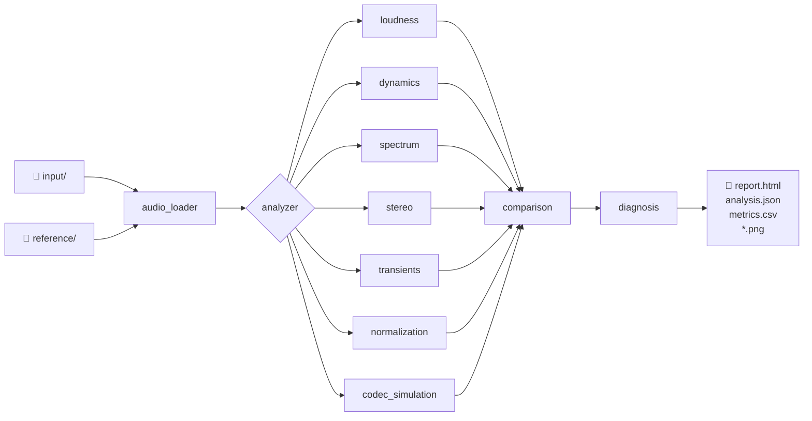

<div align="center">

# 🎚️ MasterCheck

**Local audio mix & mastering analyzer — measured facts kept separate from hypotheses.**

[](mastercheck/__init__.py)
[](https://www.python.org/)
[](#tests)
[](#2-installation)
[](#)
[](https://github.com/Sappyhad/master-analyzer/commits)
[](https://github.com/Sappyhad/master-analyzer)
[](LICENSE)

[](https://numpy.org/)
[](https://scipy.org/)
[](https://pandas.pydata.org/)
[](https://matplotlib.org/)
[](https://github.com/bastibe/python-soundfile)
[](https://github.com/csteinmetz1/pyloudnorm)
[](https://ffmpeg.org/)

[](https://www.itu.int/rec/R-REC-BS.1770)
[](https://tech.ebu.ch/publications/r128)
[](https://tech.ebu.ch/publications/tech3341)
[](https://tech.ebu.ch/publications/tech3342)

[](#2-installation)
[](#output)

[Quick start](#-quick-start) •
[Features](#-features) •
[Installation](#2-installation) •
[Usage](#3-usage) •
[Metrics](#4-what-is-measured-and-how) •
[Report](#6-how-to-read-the-report)

</div>

---

Measures loudness (BS.1770-4 / EBU R128), true peak, dynamics, tonal balance, stereo/phase and clipping,
simulates streaming normalization and lossy codecs, compares the track with references and produces a diagnosis
that **keeps measured facts separate from hypotheses**.

> [!NOTE]
> MasterCheck supports decisions — it does not replace listening on a calibrated monitoring chain. It does not rate
> a master as "good/bad" and does not pretend to know the limiter's gain reduction.

## ⚡ Quick start

```bash
python -m venv .venv
source .venv/bin/activate          # Windows: .\.venv\Scripts\Activate.ps1
pip install -r requirements.txt
python main.py --input "input/my_master.wav"
```

Drop 2–5 references of the same genre into `reference/` — they are compared automatically.
The result lands in `output/<name>_<timestamp>/report.html`.

## ✨ Features

| | |
|---|---|
| 🔊 **Loudness** | LUFS-I / S / M, LRA, true peak (oversampling), RMS, crest, PLR |
| 📈 **Dynamics** | windowed crest, peak density, energy sections, loudest section, pumping |
| 🎛️ **Spectrum** | Welch PSD, band energy, tilt, resonances, codec low-pass detection |
| 🎧 **Stereo / phase** | correlation, M/S, L/R balance, mono fold-down, phase regions |
| ⚠️ **Clipping** | *detected* vs *suspected* distinction, transient prominence |
| 📡 **Streaming** | normalization simulation and real MP3/AAC encoding via FFmpeg |
| 🆚 **References** | raw comparison, loudness-matched comparison and loudest-section comparison |
| 🩺 **Diagnosis** | type, confidence, evidence, possible causes, tests to run, what to avoid |
| 📄 **Report** | `report.html`, `analysis.json`, `metrics.csv`, PNG plots |

## 🔄 How it works



## 📚 Table of contents

1. [Architecture](#1-architecture)
2. [Installation](#2-installation)
3. [Usage](#3-usage)
4. [What is measured and how](#4-what-is-measured-and-how)
5. [Comparison with references](#5-comparison-with-references)
6. [How to read the report](#6-how-to-read-the-report)
7. [Configuration](#7-configuration-configjson)
8. [Error handling](#8-error-handling)

---

## 1. Architecture

```
master-analyzer/
├── main.py                  # entry point, checks dependencies
├── config.json              # thresholds, bands, codecs, genre profiles
├── requirements.txt
├── input/  reference/  output/
├── mastercheck/
│   ├── audio_loader.py      # decoding (soundfile / FFmpeg), validation, memory limits
│   ├── loudness.py          # K-weighting, LUFS-I/S/M, LRA, true peak, RMS, crest, PLR
│   ├── dynamics.py          # windowed crest, peak density, sections, loudest section, pumping
│   ├── spectrum.py          # Welch PSD, band energy, tilt, resonances, codec low-pass detection
│   ├── stereo.py            # correlation, M/S, L/R balance, mono fold-down, phase regions
│   ├── transients.py        # detected vs suspected clipping, transient prominence
│   ├── normalization.py     # normalization simulation (gain-only / peak-limited)
│   ├── codec_simulation.py  # real MP3/AAC encoding via FFmpeg and re-measurement
│   ├── analyzer.py          # single-file orchestration, headline metrics
│   ├── comparison.py        # reference comparison: raw, loudness-matched, sections
│   ├── diagnosis.py         # diagnostic rules + answers to the key questions
│   ├── plots.py             # PNG plots
│   ├── report.py            # report.html, analysis.json, metrics.csv, terminal summary
│   ├── models.py, config.py, errors.py, cli.py
└── tests/                   # pytest: BS.1770/EBU compliance, loader, metrics, diagnosis
```

### Why these libraries

| Library | Purpose | Notes |
|---|---|---|
| numpy / scipy | FFT, IIR filters (K-weighting), polyphase oversampling (true peak), Welch, STFT | the standard for DSP in Python |
| soundfile (libsndfile) | WAV 16/24/32/float, FLAC, AIFF, OGG, MP3 | decodes to float64 without clipping overs |
| pyloudnorm | independent LUFS-I check | the in-house BS.1770-4 implementation is verified against it |
| matplotlib | PNG plots | Agg backend, no GUI |
| pandas | CSV export | |
| FFmpeg (system or `imageio-ffmpeg`) | M4A/AAC/ALAC, codec simulation | optional; everything else works without it |

> [!TIP]
> **librosa is deliberately left out** — it is heavy (numba/llvmlite, frequent install issues on Windows),
> and everything needed (STFT, filters, resampling) is provided by scipy.

---

## 2. Installation

Requires Python **3.10+**.

<details open>
<summary><b>🪟 Windows (PowerShell)</b></summary>

```powershell
cd master-analyzer
python -m venv .venv
.\.venv\Scripts\Activate.ps1
pip install -r requirements.txt
```

FFmpeg: `imageio-ffmpeg` from requirements ships a ready-made binary — nothing else is needed.
Alternatively, a system install: `winget install Gyan.FFmpeg` (must be on PATH).

</details>

<details>
<summary><b>🍎 macOS / 🐧 Linux</b></summary>

```bash
cd master-analyzer
python3 -m venv .venv
source .venv/bin/activate
pip install -r requirements.txt
# optional system FFmpeg:
brew install ffmpeg            # macOS
sudo apt install ffmpeg        # Debian/Ubuntu
```

On Linux, if `soundfile` reports a missing libsndfile: `sudo apt install libsndfile1`.

</details>

### Supported formats

| Decoder | Extensions |
|---|---|
| soundfile | `.wav` `.wave` `.flac` `.aif` `.aiff` `.ogg` `.mp3` |
| FFmpeg | `.m4a` `.aac` `.mp4` `.alac` |

Mono and stereo. Prefer a lossless master — lossy files alter the true peak and the top octave.

### Tests

```bash
python -m pytest -q
```

---

## 3. Usage

```bash
# basic — automatically uses the files in reference/, if any
python main.py --input "input/my_master.wav"

# a different reference folder
python main.py --input "input/my_master.wav" --reference-dir "D:/refs/techno"

# only the 00:45–01:15 section (seconds or mm:ss)
python main.py --input "input/my_master.wav" --start 45 --end 75
python main.py --input "input/my_master.wav" --start 00:45 --end 01:15

# compare specific ranges: track 45–75 s vs references 60–90 s
python main.py --input "input/my_master.wav" --start 45 --end 75 --ref-start 60 --ref-end 90

# normalization simulation target and true peak ceiling
python main.py --input "input/my_master.wav" --target-lufs -14 --tp-ceiling -1

# fast: no references, no codecs, no plots
python main.py --input "input/my_master.wav" --no-reference --no-codec --no-plots

# genre profile (only for reference-free heuristics), custom config
python main.py --input "input/my_master.wav" --genre edm --config my_thresholds.json
```

<details>
<summary><b>All CLI options</b> (<code>python main.py --help</code>)</summary>

| Option | Meaning |
|---|---|
| `--input`, `-i` | file to analyze (required) |
| `--reference-dir`, `-r` | reference folder (default `reference/`) |
| `--no-reference` | skip references |
| `--start`, `--end` | analysis range of the track (seconds or `mm:ss`) |
| `--ref-start`, `--ref-end` | analysis range of each reference |
| `--target-lufs` | normalization simulation target |
| `--tp-ceiling` | true peak ceiling in the normalization simulation |
| `--tp-limit` | true peak warning threshold in the diagnosis |
| `--genre` | profile from `config.json → genre_profiles` |
| `--no-codec`, `--no-plots` | skip codecs / plots |
| `--output-dir`, `-o` | parent output folder (default `output/`) |
| `--config` | extra JSON overriding `config.json` |
| `--verbose`, `-v` | debug logging |

</details>

### Output

Every run creates `output/<name>_<YYYYMMDD_HHMMSS>/`:

| File | Contents |
|---|---|
| `report.html` | full report: summary, diagnoses, tables, plots, limitations |
| `analysis.json` | all data, including LUFS-M/S and correlation over time |
| `metrics.csv` | metrics table: track, each reference, median, difference |
| `waveform.png` `loudness.png` `spectrum.png` `spectrogram.png` `dynamics.png` `stereo.png` | plots |
| `comparison_*.png` | comparison plots — when references are present |

> [!IMPORTANT]
> Original audio files are read-only. The codec simulation works on a temporary copy.

---

## 4. What is measured and how

Every metric in the report has a unit, a method and a status:

| Status | Meaning |
|---|---|
|  | implementation of a standard |
|  | method with known limitations |
|  | simple arithmetic, definition given |
|  | an indicator, not a physical quantity |
|  | could not be computed reliably — no made-up values |

| Metric | Method | Status |
|---|---|---|
| LUFS-I | BS.1770-4: K-weighting, 400 ms blocks / 75 % overlap, −70 LUFS and −10 LU gates. Value from pyloudnorm, cross-checked with the in-house implementation | standard |
| LUFS-M / LUFS-S | 400 ms / 3 s windows, 10 Hz refresh (EBU Tech 3341) | standard |
| LRA | EBU Tech 3342: 3 s blocks, −70 LUFS and −20 LU gates, 95th − 10th percentile | standard |
| True peak | 4× oversampling (for 44.1/48 kHz; 2× for 88.2/96 kHz), Kaiser FIR, 48 taps/phase | approximation — may underestimate real inter-sample peaks (BS.1770-4: up to ~0.7 dB for 4× in the worst case) |
| Sample peak | max \|sample\| | standard — **this is not true peak** |
| RMS | unweighted, all channels, full range; 0 dBFS sine = −3.01 dBFS (no AES17 offset) | derived |
| Crest factor | sample peak − RMS (dB), whole file + median over 400 ms windows | derived |
| PLR | true peak − LUFS-I | derived |
| Correlation | Σ L·R / √(ΣL²·ΣR²), whole file, in 1 s windows and for the < 150 Hz band | derived |
| Side/Mid | 20·log10(RMS(S)/RMS(M)), M=(L+R)/2, S=(L−R)/2 | derived |
| Mono fold-down | LUFS-I [M,M] − LUFS-I [L,R] | derived |
| Bands | integral of the Welch PSD (Hann, 50 %) of the mid signal; % of 20 Hz–20 kHz energy and dB | derived |

> [!WARNING]
> Limitations the report states explicitly:
>
> - **Limiter gain reduction cannot be measured** from a finished stereo file. The indicators (crest, peak density, PLR, LRA, transient prominence) describe the effect, not the process.
> - **Clipping**: "detected" = samples > 0 dBFS (float files) or repeated flat runs at full scale with sharp edges. "suspected" = flat tops below 0 dBFS (e.g. clipping followed by a gain reduction, or an intentional clipper). At which production stage it happened cannot be proven.
> - **Sections** are energy levels (LUFS-S clustering), not recognized verses/choruses.
> - **Pumping** is a weak statistical hint (negative correlation of envelope fluctuations < 120 Hz vs 2–8 kHz).
> - **Normalization** and **codecs** are simulations, not a replica of Spotify/Apple Music/YouTube.

---

## 5. Comparison with references

For each reference the report shows three views:

1. **Raw values** — track, reference and difference for all headline metrics.
2. **Loudness-matched** — the reference is *virtually* shifted by (track LUFS-I − reference LUFS-I) dB,
   using the same BS.1770-4 meter for both files. The applied gain is shown. Band levels, TP and RMS
   are compared at equal loudness — tonal differences are not confused with playback loudness.
   Files are not modified: a gain shift moves every dB value by the same amount, so this is exact arithmetic.
3. **Loudest section** — the 15 s window (configurable) with the highest LUFS-M energy in each file.

With several references: results for each one separately + median/min/max and an "outside the reference range" flag.

> [!TIP]
> Use 2–5 commercial masters of the same genre and similar arrangement, preferably lossless.
> No single reference is the target — look at the median and the range.

---

## 6. How to read the report

1. **Summary** — answers to the key questions (is the peak safe? dynamics vs references? tonal balance?
   clipping? behavior after normalization? what to check first? what cannot be determined?).
2. **Diagnosis** — every diagnosis has:

   | Field | Meaning |
   |---|---|
   | type | **measured problem** (measurable fact), **potential issue** (hypothesis), **observation** (information) |
   | **confidence** | low / medium / high |
   | **Evidence** | measured values |
   | **Possible causes** | hypotheses |
   | **Suggested tests** | what to listen to / check |
   | **Recommended action** / **May make it worse** | what to do and what to avoid |
   | **Missing information** | what is missing for a confident diagnosis |

3. Tables and plots for each domain.

### 💡 Practical tips

- High true peak ≠ bad master. It is a risk for lossy encoding — check the codec section and the limiter's ISP mode.
- Low LUFS-I vs references: compare at matched loudness first (the "matched" table). The difference is often the midrange, transients or excess bass eating headroom — not "too little limiting".
- High LUFS-I but the master sounds weak: look at tonal balance, clipping and transient prominence — don't add more limiting.
- Correlation close to +1 is not a flaw; wide stereo is not a virtue. What matters is the mono fold-down and the low band.
- Thresholds in `config.json` are starting points — adjust them to the genre.

---

## 7. Configuration (`config.json`)

| Key | What it sets |
|---|---|
| `analysis` | true peak oversampling, memory limit, windows, loudest-section length, FFT resolution |
| `bands` / `band_groups` | band ranges and groups (bass/mid/high) used in comparisons |
| `normalization` | default LUFS target and TP ceiling |
| `codec_simulation` | list of FFmpeg encoders and bitrates |
| `thresholds` | all diagnosis warning thresholds |
| `genre_profiles` | rough limits for band energy share; used **only without references** and only to flag extremes |

A custom file passed via `--config` is merged with the default one — only the changed keys are needed:

```json
{
  "normalization": { "target_lufs": -16.0 },
  "thresholds": { "true_peak_max_dbtp": -2.0 }
}
```

---

## 8. Error handling

Clear messages (no tracebacks) for:

- a missing file, unsupported extension, corrupted/unreadable file,
- NaN/Inf in the data, digital silence, a recording that is too short (< 0.4 s), > 2 channels,
- exceeding the memory limit (`analysis.max_memory_mb`, suggests `--start/--end`),
- missing FFmpeg (M4A/AAC and codecs), missing Python libraries (checked in `main.py`),
- an invalid `config.json`.

A corrupted reference is skipped with a warning — the analysis continues.

---

## 📜 License

[MIT](LICENSE) © Sappyhad
